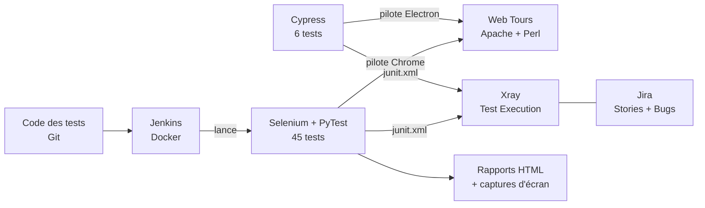

# Projet de test logiciel
## Site de réservation de vols « Web Tours »

**Jira · Xray · Selenium · Cypress · Jenkins · Git**

Yessin Rekik

> Ce document peut se lire comme un texte normal, ou s'afficher en diaporama
> (extension VS Code « Marp » : chaque `---` est une nouvelle diapositive).

---

## 1. Le sujet en une phrase

> Installer une application web de réservation de vols, **la tester de façon
> organisée** (manuellement puis automatiquement), **trouver ses défauts**, et faire
> tourner les tests **automatiquement à chaque modification** du code.

L'énoncé (`work.txt`) est en deux parties :

| Partie 1 : gestion des tests | Partie 2 : automatisation |
|---|---|
| Projet Jira au nom de l'application | Tests automatiques avec **Selenium et Cypress** + comparaison |
| User stories | Exécuter la suite et analyser les résultats |
| Plan de test Xray, tests liés aux stories | Mettre le projet sur **Git** |
| Plan d'exécution exécuté | Lancer les tests via **Jenkins** |

---

## 2. L'application testée : Web Tours

- Application de démonstration fournie par HP/Micro Focus pour apprendre le test.
- Un petit serveur **Apache** local qui exécute des scripts **Perl** (CGI).
- Adresse : `http://127.0.0.1:1080/WebTours/index.htm`

Ce qu'un client peut y faire :

1. **S'inscrire** puis **se connecter**
2. **Chercher un vol** (ville de départ/arrivée, date, nombre de passagers, classe)
3. **Réserver et payer** (carte bancaire fictive), recevoir une facture
4. **Consulter son itinéraire** et **annuler** des réservations

Particularité technique : les pages sont découpées en **frames** (cadres HTML
imbriqués), une technologie ancienne qui complique l'automatisation.

---

## 3. Les outils, expliqués simplement

| Outil | Rôle | Analogie |
|---|---|---|
| **Jira** | Liste des fonctionnalités à livrer (*user stories*) et des bugs | Le cahier des charges + le registre des pannes |
| **Xray** (extension de Jira) | Décrit chaque test, le relie à une story, enregistre les résultats | Le carnet de contrôle qualité |
| **Selenium** | Pilote un vrai navigateur Chrome par programme (clique, tape, lit) | Un robot qui utilise le site à notre place |
| **PyTest** | Lance les tests Python et produit les rapports | Le chef d'orchestre des tests |
| **Cypress** | Autre outil de pilotage de navigateur (JavaScript) | Un second robot, pour comparer |
| **Git** | Garde l'historique de toutes les versions du projet | Un « historique des modifications » |
| **Jenkins** | Relance automatiquement tous les tests | Un contrôleur qui repasse tout à chaque changement |
| **Docker** | Fait tourner Jenkins dans un conteneur prêt à l'emploi | Une machine virtuelle légère |

---

## 4. Vue d'ensemble



En clair : Jenkins récupère le code depuis Git, lance les tests Selenium sur Web Tours,
puis envoie les résultats dans Xray, où ils sont reliés aux user stories et aux bugs.

---

## 5. Partie 1 : Jira et Xray

**Projet Jira `WT` (Web Tours)**

- **5 epics** (grands thèmes) : Authentification, Recherche, Réservation, Itinéraire, Sécurité
- **14 user stories** (WT-6 à WT-19), par ex. *« En tant que client, je veux annuler une
  réservation »*

**Xray**

- **45 tests manuels** avec étapes, données et résultat attendu
- chaque test est **lié à sa user story** (traçabilité, voir `docs/test-plan.md`)
- rangés en **4 dossiers** : `FT`, `ET`, `BT`, `PT`
- **Plan de test WT-65**, plusieurs **exécutions** : WT-66 (référence), WT-72 (Selenium),
  WT-73 (Cypress), WT-74 (lancée par Jenkins)
- **5 bugs** créés dans Jira (WT-67 à WT-71)

Tout cela a été créé **par des scripts Python** (`scripts/`) via les API Jira et Xray :
c'est reproductible, et on peut relancer les scripts sans créer de doublons.

---

## 6. Les 4 familles de tests (exigées par l'énoncé)

| Dossier | Nom | Question posée | Exemple | Nb |
|---|---|---|---|---|
| **FT** | Functional Testing | Le parcours normal fonctionne-t-il ? | Réserver un vol et obtenir la facture | 18 |
| **ET** | Error Testing | L'application refuse-t-elle les saisies invalides ? | Payer sans numéro de carte | 14 |
| **BT** | Boundary Testing | Que se passe-t-il aux limites ? | 0, 1, 8, 999 passagers ; nom de 20 caractères | 8 |
| **PT** | Permission Testing | Les accès sont-ils protégés ? | Ouvrir l'itinéraire sans être connecté | 5 |

**Total : 45 tests**, chacun existe **deux fois** : en test manuel dans Xray et en
test automatique Python, avec le même identifiant (`FT-10`, `ET-11`…).

---

## 7. Partie 2 : l'automatisation avec Selenium

Organisation du code (`webtours-tests/`) :

```
webtours/app.py     « Page Object » : une classe qui sait se connecter,
                    chercher, réserver, payer… (les tests ne touchent
                    jamais directement au HTML)
webtours/api.py     création de comptes par requête HTTP (rapide)
conftest.py         ouvre / ferme Chrome, capture d'écran si échec
tests/ft|et|bt|pt   les 45 tests, un dossier par famille
```

Exemple de test (lisible même sans connaître Python) :

```python
def test_ft_10_complete_booking_shows_invoice(logged_app):
    price = _open_payment(logged_app)              # chercher + choisir un vol
    logged_app.pay(card="12345678", exp="12/30")   # payer
    text = logged_app.page_text()
    assert "Thank you for booking through Web Tours" in text
    assert total_from(text) == price               # le total facturé est juste
```

Chaque test crée **son propre compte**, donc les tests sont indépendants entre eux.

---

## 8. Comment on garde une suite « verte » malgré les bugs

Certains tests **doivent** échouer, car ils détectent de vrais défauts de l'application.

On les marque `xfail` (*expected failure*), avec le numéro du bug :

```python
@pytest.mark.xfail(reason="BUG-03: paiement accepte sans numero de carte")
def test_et_11_payment_without_credit_card_is_rejected(logged_app):
```

- La suite reste stable : un échec **connu** ne casse pas le build.
- Le défaut reste visible dans les rapports et dans Xray (statut FAILED).
- Le jour où le bug est corrigé, le test se met à passer et le signale.

---

## 9. Résultats de l'exécution

| Résultat | Nombre |
|---|---|
| ✅ PASSED | **31** |
| ❌ FAILED (défauts confirmés, `xfail`) | **14** |
| Total | 45 (≈ 3 min 30) |

| Famille | Réussis | Échecs |
|---|---|---|
| FT (fonctionnel) | 18 / 18 | 0 |
| ET (erreurs) | 6 / 14 | 8 |
| BT (limites) | 4 / 8 | 4 |
| PT (permissions) | 3 / 5 | 2 |

**Lecture** : tout le parcours normal fonctionne ; les problèmes sont dans la
**validation des saisies** et le **contrôle d'accès**.
Détail : `docs/execution-report.md`, et l'exécution Xray **WT-72**.

---

## 10. Les 5 bugs trouvés

| Bug | Gravité | Problème | Tests |
|---|---|---|---|
| **WT-67** | Haute | Dates invalides, date passée, retour avant le départ : tout est accepté | ET-07…10, BT-08 |
| **WT-68** | Haute | Nombre de passagers 0, « abc » ou 999 accepté (999 champs générés !) | BT-04, 05, 07 |
| **WT-69** | Très haute | Paiement accepté sans carte, avec carte « abcdefgh » ou mois 13 | ET-11…14 |
| **WT-70** | Très haute | Pages protégées ouvertes **sans être connecté** | PT-01, 02 |
| **WT-71** | Moyenne | Vol Denver → Denver proposé à **0 $** | ET-09 |

**Cause commune trouvée en lisant le code de l'application** : les contrôles existent
en JavaScript (`purchaseValidate.js`…) mais ne sont **jamais branchés** sur les
formulaires, et le serveur ne vérifie rien. Fiches complètes : `docs/bugs.md`.

---

## 11. Selenium contre Cypress (comparaison demandée)

6 tests identiques écrits avec les deux outils (FT-00, FT-01, FT-06, FT-10, ET-01, PT-01) :

| | Selenium + PyTest | Cypress |
|---|---|---|
| Verdicts | identiques | identiques |
| Durée totale (6 tests) | ~16 s | ~16 s |
| Langage | Python (ou Java, C#…) | JavaScript seulement |
| **Frames** (cas de Web Tours) | ✅ natif | ⚠️ contournement manuel |
| Plusieurs fenêtres | ✅ | ❌ |
| Attentes | à écrire | ✅ automatiques |
| Échec attendu (`xfail`) | ✅ | ❌ pas d'équivalent |
| Débogage | captures d'écran | ✅ mode visuel « time travel » |

**Conclusion** : Selenium convient mieux à Web Tours (frames, fenêtres multiples, `xfail`).
Cypress est plus confortable pour une application web moderne.
Détail : `docs/comparison-selenium-cypress.md` · Xray : WT-72 (Selenium) / WT-73 (Cypress).

---

## 12. Intégration continue avec Jenkins

Le fichier `Jenkinsfile` décrit les étapes, exécutées à chaque build :

1. **Checkout** : récupère le code depuis Git
2. **Install dependencies** : crée l'environnement Python
3. **Check application is up** : vérifie que Web Tours répond (page HTML **et** page Perl)
4. **Run Selenium test suite** : les 45 tests, Chrome sans écran (*headless*)
5. **Publish results to Xray** : crée automatiquement une *Test Execution* dans Xray
6. **Generate execution report** : régénère le rapport Markdown

À la fin : résultats JUnit, rapport HTML et captures d'écran archivés dans Jenkins.
Build vérifié : **#4 → SUCCESS** (vert), `31 passed, 14 xfailed` en 2 min, exécution
Xray **WT-74** créée automatiquement. Les 14 `xfail` (bugs connus) ne cassent pas le
build ; un échec **inattendu** (régression) le passerait en **UNSTABLE** (jaune).

Jenkins tourne dans **Docker**, entièrement préconfiguré (`deploy/jenkins/`) :
compte admin, clés Xray et job créés automatiquement, sans aucun clic.

---

## 13. Problèmes rencontrés et corrigés

| Problème | Cause | Correction |
|---|---|---|
| Erreur **500** sur toutes les pages de Web Tours | Apache ne trouvait pas `perl` (PATH d'un terminal ouvert avant l'installation) | `scripts/start_webtours.bat` ajoute Perl au PATH avant de lancer Apache |
| Le test « application disponible » passait malgré l'erreur 500 | Il ne vérifiait que la page HTML statique | Il vérifie aussi une page Perl |
| Jenkins bloqué « *doesn't have label windows* » | Ancien `Jenkinsfile` réservé à Windows | Pipeline compatible Linux **et** Windows |
| Rapport : tous les tests numérotés « FT-00 » | Dictionnaire inversé dans `make_report.py` | Identifiants lus depuis `xray_map.json` |
| Frames inaccessibles avec Cypress | Cypress n'a pas d'API pour les frames | Commande `cy.frame()` écrite à la main |

---

# Guide pas à pas : faire tourner le projet

---

## Étape 0 : prérequis (une seule fois)

| Logiciel | Pourquoi | Vérifier |
|---|---|---|
| Java 8 | demandé par l'énoncé pour Web Tours | `java -version` |
| Strawberry Perl 5.10 (`strawberry-perl-5.10.1.0.msi`, à la racine) | exécute les pages de Web Tours | `C:\strawberry\perl\bin\perl.exe -v` |
| Python 3.10+ | tests Selenium et scripts | `python --version` |
| Google Chrome | navigateur piloté par Selenium | — |
| Node.js 18+ | tests Cypress | `node -v` |
| Docker Desktop (optionnel) | Jenkins | `docker -v` |

Le serveur Web Tours doit se trouver dans le dossier `WebTours\` du projet
(non versionné, car c'est une application tierce).

> Après avoir installé Perl, **ouvrir un nouveau terminal** (sinon le PATH n'est pas à jour).

---

## Étape 1 : démarrer l'application

```powershell
cd E:\hw_jira
.\scripts\start_webtours.bat
```

Laisser cette fenêtre ouverte. Dans le navigateur :
**http://127.0.0.1:1080/WebTours/index.htm** → la page d'accueil Web Tours s'affiche
avec le formulaire de connexion à gauche.

Vérification automatique (dans un autre terminal) :

```powershell
.\.venv\Scripts\python scripts\check_app.py
# [1] GET .../index.htm -> HTTP 200
# [1] GET .../welcome.pl?signOff=true -> HTTP 200
```

---

## Étape 2 : installer l'environnement Python (une seule fois)

```powershell
cd E:\hw_jira
python -m venv .venv
.\.venv\Scripts\python -m pip install -r webtours-tests\requirements.txt
```

Cela installe Selenium, PyTest, le générateur de rapports HTML, etc.
Selenium télécharge tout seul le bon pilote pour Chrome.

---

## Étape 3 : lancer les 45 tests Selenium

```powershell
cd E:\hw_jira\webtours-tests
..\.venv\Scripts\python -m pytest
```

Résultat attendu (≈ 3 min 30) :

```
31 passed, 14 xfailed
```

Variantes utiles pour la démonstration :

```powershell
..\.venv\Scripts\python -m pytest -m ft                 # seulement le fonctionnel
..\.venv\Scripts\python -m pytest -m pt                 # seulement les permissions
$env:HEADLESS="0"; ..\.venv\Scripts\python -m pytest -k ft_10   # voir Chrome travailler
```

---

## Étape 4 : consulter les résultats

| Fichier | Contenu |
|---|---|
| `webtours-tests\reports\report.html` | rapport visuel (ouvrir dans le navigateur) |
| `webtours-tests\reports\junit.xml` | format standard lu par Jenkins et Xray |
| `webtours-tests\reports\screenshots\` | capture d'écran de chaque test en échec |

Régénérer le rapport Markdown :

```powershell
cd E:\hw_jira
.\.venv\Scripts\python scripts\make_report.py     # -> docs\execution-report.md
```

---

## Étape 5 : lancer la suite Cypress

```powershell
cd E:\hw_jira\cypress-tests
npm install            # une seule fois (télécharge Cypress, ~500 Mo)
npx cypress run        # 6 tests, sans fenêtre
npx cypress open       # mode interactif : on voit chaque étape
```

Résultat attendu : `6 passing`.

---

## Étape 6 : envoyer les résultats dans Xray (optionnel)

Il faut un fichier `.env` à la racine (non versionné, il contient les clés) :

```
URL=https://<site>.atlassian.net
EMAIL=<email>
JIRA_API=<token API Jira>
XRAY_CLIENT_ID=<id>
XRAY_CLIENT_SECRET=<secret>
```

```powershell
.\.venv\Scripts\python scripts\results_to_xray.py --plan WT-65
.\.venv\Scripts\python scripts\results_to_xray.py --plan WT-65 `
    --junit cypress-tests\reports\junit.xml --summary "Execution Cypress"
# -> Test Execution: WT-xx
```

Dans Jira : ouvrir le plan **WT-65** → onglet des exécutions → la nouvelle exécution
apparaît avec le statut de chaque test.

---

## Étape 7 : Jenkins avec Docker

```powershell
cd E:\hw_jira\deploy\jenkins
$env:XRAY_CLIENT_ID="<id>"; $env:XRAY_CLIENT_SECRET="<secret>"
docker compose up -d --build        # 1re fois : quelques minutes
```

1. Ouvrir **http://localhost:8080**, se connecter avec `admin` / `admin`
2. Cliquer sur le job **webtours-tests**, puis **Build Now**
3. Suivre **Console Output** ; à la fin : **Test Result** (graphique) et
   **Rapport PyTest Web Tours** (HTML)

⚠️ Jenkins lit le dépôt Git local : il ne voit que les modifications **commitées**
(`git commit`). Web Tours doit tourner sur la machine (étape 1).

---

## Scénario de démonstration conseillé (10 min)

1. **Montrer l'application** (1 min) : se connecter, chercher un vol, réserver.
2. **Montrer un bug à la main** (1 min) : payer avec la carte `abcdefgh` → facture acceptée.
3. **Jira/Xray** (2 min) : une user story → ses tests liés → plan WT-65 → exécution WT-72 → bug WT-69.
4. **Lancer un test visible** (1 min) : `$env:HEADLESS="0"; ..\.venv\Scripts\python -m pytest -k ft_10`.
5. **Rapport HTML** (1 min) : ouvrir `report.html`, montrer un `xfail` et sa raison.
6. **Cypress** (2 min) : `npx cypress open`, lancer la suite, montrer le *time travel*.
7. **Jenkins** (2 min) : Build Now → stages → Test Result → nouvelle exécution dans Xray.

---

## Questions probables du professeur

**Pourquoi 14 tests en échec ?** Ce ne sont pas des erreurs des tests : ce sont de vrais
défauts de l'application, documentés par 5 bugs Jira. Les marquer `xfail` garde la
suite exploitable.

**Pourquoi Selenium comme outil principal ?** Web Tours utilise des frames et ouvre
des fenêtres : Selenium les gère nativement, Cypress non (voir la comparaison).

**Comment sait-on qu'un test couvre une exigence ?** Chaque test Xray est lié à une
user story ; la matrice est dans `docs/test-plan.md`.

**Les tests sont-ils indépendants ?** Oui : chaque test crée son propre compte
utilisateur et ouvre un navigateur neuf.

**Que se passe-t-il si quelqu'un modifie le code ?** Jenkins relance les 45 tests
(scrutation Git toutes les 15 min) et publie une nouvelle exécution dans Xray.

---

## Où trouver quoi

| Besoin | Fichier |
|---|---|
| Énoncé | `work.txt` |
| Plan de test et traçabilité | `docs/test-plan.md` |
| Bugs détaillés | `docs/bugs.md` |
| Dernier rapport d'exécution | `docs/execution-report.md` |
| Comparaison Selenium / Cypress | `docs/comparison-selenium-cypress.md` |
| Mise en place de Jenkins | `docs/jenkins.md` |
| Tests Selenium | `webtours-tests/tests/` |
| Tests Cypress | `cypress-tests/cypress/e2e/` |
| Scripts Jira / Xray | `scripts/` |

**Merci !**
