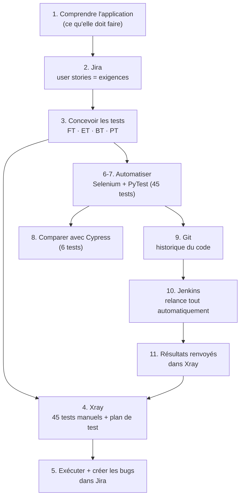
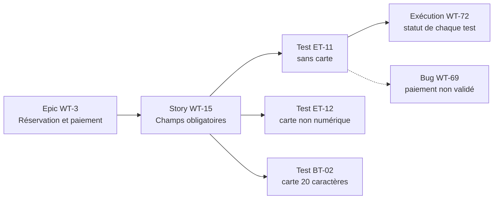
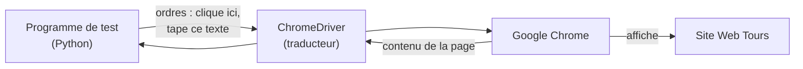
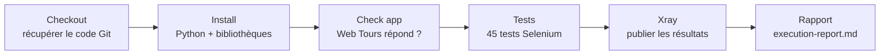

# Guide du projet QA, expliqué depuis zéro

Ce guide explique **comment fonctionne le projet de test**, pas l'application testée.
Il part de zéro : aucune connaissance préalable en test logiciel, Jira, Selenium ou
Jenkins n'est nécessaire. Chaque notion est expliquée la première fois qu'elle apparaît,
et un glossaire se trouve à la fin.

**Sommaire**

1. [C'est quoi le test logiciel (QA) ?](#1-cest-quoi-le-test-logiciel-qa-)
2. [Le projet en une image](#2-le-projet-en-une-image)
3. [Étape 1 : comprendre ce que l'application doit faire](#3-étape-1--comprendre-ce-que-lapplication-doit-faire)
4. [Étape 2 : écrire les exigences dans Jira (user stories)](#4-étape-2--écrire-les-exigences-dans-jira-user-stories)
5. [Étape 3 : concevoir les tests (FT, ET, BT, PT)](#5-étape-3--concevoir-les-tests-ft-et-bt-pt)
6. [Étape 4 : organiser les tests dans Xray](#6-étape-4--organiser-les-tests-dans-xray)
7. [Étape 5 : exécuter les tests et signaler les bugs](#7-étape-5--exécuter-les-tests-et-signaler-les-bugs)
8. [Étape 6 : automatiser avec Selenium](#8-étape-6--automatiser-avec-selenium)
9. [Étape 7 : PyTest, le chef d'orchestre](#9-étape-7--pytest-le-chef-dorchestre)
10. [Étape 8 : un deuxième outil, Cypress, pour comparer](#10-étape-8--un-deuxième-outil-cypress-pour-comparer)
11. [Étape 9 : Git, garder l'historique](#11-étape-9--git-garder-lhistorique)
12. [Étape 10 : Jenkins, tout relancer automatiquement](#12-étape-10--jenkins-tout-relancer-automatiquement)
13. [Étape 11 : boucler la boucle (résultats renvoyés dans Xray)](#13-étape-11--boucler-la-boucle-résultats-renvoyés-dans-xray)
14. [La vie d'un test, du début à la fin](#14-la-vie-dun-test-du-début-à-la-fin)
15. [Les scripts : qui fait quoi](#15-les-scripts--qui-fait-quoi)
16. [Glossaire](#16-glossaire)
17. [Questions fréquentes](#17-questions-fréquentes)

---

## 1. C'est quoi le test logiciel (QA) ?

**QA** veut dire *Quality Assurance*, « assurance qualité ». Le but est simple :
**vérifier qu'un logiciel fait ce qu'il est censé faire, et trouver ce qui ne marche pas
avant que les utilisateurs ne le découvrent.**

Une analogie : un contrôleur technique automobile.

| Contrôle technique | Test logiciel |
|---|---|
| Une liste officielle de points à vérifier (freins, phares…) | Une liste de **cas de test** |
| Chaque point a un résultat attendu (« les freins arrêtent la voiture ») | Chaque test a un **résultat attendu** |
| Le contrôleur essaie, puis note OK ou défaut | Le testeur exécute le test et note **PASS** ou **FAIL** |
| Un procès-verbal liste les défauts | Des **rapports de bug** sont créés |
| On revient après réparation pour revérifier | On relance les tests après chaque modification (**régression**) |

Il existe deux façons de tester :

- **Test manuel** : une personne suit les étapes à la main, dans le navigateur.
  Facile à démarrer, mais lent et répétitif.
- **Test automatisé** : un programme suit les mêmes étapes tout seul. Plus long à
  écrire au départ, mais ensuite on peut relancer des dizaines de tests en quelques
  minutes, autant de fois qu'on veut.

Ce projet fait **les deux** : 45 tests sont décrits pour être exécutés à la main, et
les mêmes 45 tests existent sous forme de programme.

---

## 2. Le projet en une image



Le projet suit le chemin d'un vrai service QA en entreprise : **on définit ce qu'il
faut vérifier, on le vérifie, on note les problèmes, puis on automatise pour pouvoir
revérifier sans effort.**

L'application testée s'appelle **Web Tours** : un site de démonstration de réservation
de vols (connexion, recherche de vols, paiement, itinéraire). Elle tourne sur
l'ordinateur, à l'adresse `http://127.0.0.1:1080/WebTours/index.htm`. Pour ce guide,
il suffit de savoir que c'est **la chose qu'on teste**.

---

## 3. Étape 1 : comprendre ce que l'application doit faire

On ne peut pas dire qu'un logiciel « marche » sans savoir **ce qu'il est censé faire**.
La première étape est donc d'utiliser l'application à la main et d'en faire
l'inventaire :

| Module | Ce que l'utilisateur peut faire |
|---|---|
| Authentification | s'inscrire, se connecter, se déconnecter |
| Recherche | chercher un vol aller simple ou aller-retour, choisir la classe et le siège |
| Réservation | choisir un vol, payer, recevoir une facture |
| Itinéraire | voir ses réservations, en annuler une ou toutes |
| Sécurité | les pages privées ne doivent être visibles qu'une fois connecté |

Ces 5 modules deviennent les 5 grands thèmes (**epics**) du projet Jira.

---

## 4. Étape 2 : écrire les exigences dans Jira (user stories)

### Jira, c'est quoi ?

**Jira** est un site web (de la société Atlassian) où les équipes notent tout le
travail à faire, sous forme de **tickets** (appelés *issues*). Chaque ticket a un
numéro unique : ici `WT-1`, `WT-2`… (`WT` = Web Tours).

### Epics et user stories

- Un **epic** est un grand thème : « Authentification et compte ».
- Une **user story** est une exigence vue par l'utilisateur, toujours écrite avec la
  même phrase type :

> **En tant que** client, **je veux** annuler une réservation précise,
> **afin de** ne plus payer un vol non désiré.

Chaque story contient des **critères d'acceptation**, c'est-à-dire les conditions
précises qui permettent de dire « c'est fait correctement » :

- La case du vol peut être cochée puis « Cancel Reservation » appliqué.
- Le vol annulé disparaît de l'itinéraire.
- Les autres réservations restent intactes.

Ces critères sont la matière première des tests : **chaque critère donnera au moins
un test.**

### Dans ce projet

- **5 epics** (WT-1 à WT-5), un par module ;
- **14 user stories** (WT-6 à WT-19).

Elles n'ont pas été tapées à la main : le script `scripts/jira_seed.py` les crée en
parlant directement à Jira par son **API** (une « porte d'entrée » qui permet à un
programme de lire et d'écrire dans Jira, comme le ferait un humain avec la souris).

---

## 5. Étape 3 : concevoir les tests (FT, ET, BT, PT)

### Anatomie d'un cas de test

Un **cas de test** est une recette précise, que n'importe qui peut suivre et qui
donne toujours le même verdict :

| Élément | Exemple (test ET-11) |
|---|---|
| Identifiant | ET-11 |
| Titre | Paiement sans numéro de carte |
| Exigence couverte | WT-15 « les champs obligatoires du paiement sont validés » |
| Étapes | 1. Ouvrir le site · 2. Se connecter · 3. Chercher un vol Denver → Frankfurt · 4. Choisir le premier vol · 5. Laisser *Credit Card* vide et cliquer sur *Buy Flights* |
| Résultat attendu | Le paiement doit être refusé avec un message |

### Les 4 familles de tests demandées par l'énoncé

Chaque famille pose une question différente à l'application :

| Famille | Question | Technique utilisée | Exemple | Nb |
|---|---|---|---|---|
| **FT** – Functional Testing | « Le parcours normal fonctionne-t-il ? » | Suivre chaque critère d'acceptation | Réserver un vol et obtenir la facture | 18 |
| **ET** – Error Testing | « L'application refuse-t-elle ce qui est faux ? » | Essayer des saisies invalides | Payer avec la carte `abcdefgh` | 14 |
| **BT** – Boundary Testing | « Que se passe-t-il aux limites ? » | Analyse des valeurs limites | 0, 1, 8 et 999 passagers | 8 |
| **PT** – Permission Testing | « Les accès sont-ils protégés ? » | Accéder sans droits | Ouvrir l'itinéraire sans être connecté | 5 |

**Pourquoi tester les limites ?** L'expérience montre que les erreurs se cachent aux
frontières. Si l'on peut réserver de 1 à 8 passagers, on teste précisément 0 (juste
en dessous), 1 (la limite basse), 8 (la limite haute) et une valeur absurde (999),
plutôt que des valeurs « au milieu » comme 4, qui marchent presque toujours.

**Total : 45 tests.**

---

## 6. Étape 4 : organiser les tests dans Xray

### Xray, c'est quoi ?

**Xray** est une extension de Jira spécialisée dans le test. Elle ajoute à Jira de
nouveaux types de tickets :

| Type de ticket Xray | Rôle | Dans ce projet |
|---|---|---|
| **Test** | Un cas de test, avec ses étapes et résultats attendus | 45 tickets (WT-20 à WT-64) |
| **Test Plan** | La liste des tests qu'on prévoit d'exécuter | WT-65 |
| **Test Execution** | Une séance d'exécution : chaque test y reçoit un statut (PASS/FAIL) | WT-66, WT-72, WT-73, WT-74 |

Les tests sont rangés dans des **dossiers** qui reprennent les familles :
`/FT/Authentification`, `/FT/Recherche`, `/ET/Paiement`, `/BT`, `/PT`…

### La traçabilité

Chaque test est **relié à la user story qu'il vérifie** (lien Jira de type « Test »).
Résultat : depuis une exigence, on voit immédiatement quels tests la couvrent et
s'ils passent. C'est ce qu'on appelle la **traçabilité**, et c'est ce qui permet de
répondre à la question « est-ce que tout ce qui a été demandé a été vérifié ? ».



La matrice complète story ↔ tests est dans `docs/test-plan.md`.

Là aussi, rien n'a été cliqué à la main : `scripts/xray_seed.py` crée les 45 tests avec
leurs étapes, les relie aux stories et crée le plan ; `scripts/xray_folders.py` range
les tests dans les dossiers. Le catalogue des tests (étapes, résultats attendus) est
écrit une seule fois dans `scripts/xray_catalog.py`.

---

## 7. Étape 5 : exécuter les tests et signaler les bugs

On exécute le plan : chaque test reçoit un statut. Quand le résultat obtenu est
différent du résultat attendu, on a trouvé un **défaut** (un *bug*), qu'on signale dans
Jira avec un **rapport de bug**.

Un bon rapport de bug permet à un développeur de reproduire le problème sans poser de
question :

| Élément | Exemple (WT-69) |
|---|---|
| Titre | Les données de paiement ne sont pas validées |
| Gravité | Très haute |
| Étapes | Réserver un vol, laisser *Credit Card* vide, cliquer *Buy Flights* |
| Attendu | Paiement refusé avec un message |
| Obtenu | Facture générée, « Thank you for booking » |
| Tests qui le révèlent | ET-11, ET-12, ET-13, ET-14 |
| Cause probable | Le contrôle JavaScript existe mais n'est pas branché au formulaire |

**5 bugs** ont été trouvés et créés dans Jira (WT-67 à WT-71) par
`scripts/jira_bugs.py`, chacun relié aux tests qui le révèlent. Détails : `docs/bugs.md`.

---

## 8. Étape 6 : automatiser avec Selenium

### L'idée

Exécuter 45 tests à la main prend des heures, et il faudrait recommencer à chaque
nouvelle version. On écrit donc un **programme qui fait la même chose qu'un testeur
humain** : ouvrir le navigateur, cliquer, taper, lire la page et vérifier le résultat.

### Selenium, c'est quoi ?

**Selenium** est une bibliothèque qui permet à un programme de **piloter un vrai
navigateur** (ici Google Chrome). Le principe :



Le programme ne « voit » pas l'écran : il retrouve les éléments de la page par leur
**identité dans le code HTML** (on parle de *localisateurs*). Par exemple, le champ de
carte bancaire s'appelle `creditCard` dans la page, donc le programme dit à Chrome :
« trouve l'élément nommé `creditCard` et écris `12345678` dedans ».

Chrome peut tourner **sans fenêtre visible** (mode *headless*), ce qui est plus rapide
et indispensable sur un serveur comme Jenkins.

### Le « Page Object » : ne pas se répéter

Plutôt que de répéter dans chaque test « trouve le champ username, tape, trouve le
champ password, tape, clique », toutes les actions sont rassemblées dans **une seule
classe** qui représente l'application : `webtours-tests/webtours/app.py`.

Elle offre des actions de haut niveau, lisibles comme des phrases :

```python
app.login("wttester", "Passw0rd")
app.search(depart="Denver", arrive="Frankfurt", passengers=1)
app.select_flight(outbound=0)
app.pay(card="12345678", exp="12/30")
```

Avantage : si le site change (un bouton renommé), on corrige **un seul endroit**, et
les 45 tests continuent de fonctionner.

### À quoi ressemble un test automatisé

Voici ET-11, le même test que dans Xray, en version programme
(`webtours-tests/tests/et/test_et_search_payment.py`) :

```python
@pytest.mark.xfail(reason="BUG-03: paiement accepte sans numero de carte")
def test_et_11_payment_without_credit_card_is_rejected(logged_app):
    _reach_payment(logged_app)                    # étapes 1 à 4 : connecté, vol choisi
    logged_app.pay(card="", exp="12/30")          # étape 5 : carte vide, Buy Flights
    text = logged_app.page_text().lower()
    assert "please" in text or "invalid" in text  # résultat attendu : un message de refus
```

- `assert` signifie « vérifie que ». Si la condition est fausse, le test **échoue**.
- `logged_app` est fourni automatiquement : un navigateur ouvert, avec un utilisateur
  neuf déjà connecté (voir l'étape suivante).
- `@pytest.mark.xfail` est expliqué juste après.

### Les difficultés techniques réglées

- **Les frames** : Web Tours découpe sa page en cadres imbriqués (une technologie
  ancienne). Le programme doit « entrer » dans le bon cadre avant de chercher un
  élément ; `app.py` s'en charge automatiquement.
- **Les attentes** : un programme est plus rapide que le site. Avant de lire une page,
  il attend qu'elle soit chargée (jusqu'à 10 secondes) au lieu de lire trop tôt.
- **L'indépendance** : chaque test crée **son propre compte** et ouvre **un navigateur
  neuf**. Un test ne peut donc pas être perturbé par les données d'un autre.

---

## 9. Étape 7 : PyTest, le chef d'orchestre

**PyTest** est l'outil qui **trouve, lance et compte** les tests Python. Il apporte
quatre choses :

1. **La découverte** : toute fonction dont le nom commence par `test_` dans le dossier
   `tests/` est un test. Une seule commande lance les 45 :
   ```powershell
   ..\.venv\Scripts\python -m pytest
   ```
2. **Les fixtures** : des « préparations » réutilisables, définies dans
   `webtours-tests/conftest.py`. Quand un test demande `logged_app`, PyTest ouvre
   Chrome, crée un compte, se connecte, donne le tout au test, puis ferme Chrome à la
   fin, même si le test a échoué.
3. **Les marqueurs** : chaque test porte sa famille (`ft`, `et`, `bt`, `pt`), ce qui
   permet de n'en lancer qu'une partie : `pytest -m pt`.
4. **Les rapports** : à chaque exécution, trois sorties sont produites dans
   `webtours-tests/reports/` :

| Fichier | Pour qui |
|---|---|
| `report.html` | les humains : un rapport lisible dans le navigateur |
| `junit.xml` | les machines : un format standard que Jenkins et Xray savent lire |
| `screenshots/` | le débogage : une capture d'écran de chaque test raté |

### `xfail` : un échec attendu

Quand un test révèle un vrai bug de l'application, il échoue, et il échouera tant que
le bug n'est pas corrigé. Pour que la suite reste utilisable, on le marque `xfail`
(*expected failure*) avec le numéro du bug :

- le résultat devient **XFAIL** (« échec attendu ») au lieu de FAIL ;
- la suite reste « verte » : seuls les échecs **inattendus** attirent l'attention ;
- le bug reste visible dans les rapports et dans Xray ;
- le jour où le bug est corrigé, le test passe et le signale.

**Résultat actuel : 31 passed, 14 xfailed** (les 14 xfail correspondent aux 5 bugs).

---

## 10. Étape 8 : un deuxième outil, Cypress, pour comparer

L'énoncé demande d'utiliser **Selenium et Cypress, avec une comparaison**.

**Cypress** est un autre outil de test de sites web, écrit en JavaScript. Différence
principale : Selenium pilote le navigateur **de l'extérieur**, alors que Cypress
s'exécute **à l'intérieur** du navigateur.

Six tests ont été réécrits avec Cypress (`cypress-tests/`), avec les mêmes
identifiants, pour comparer les deux outils sur les mêmes cas :

```javascript
it("ET-01 mot de passe incorrect refuse", () => {
  cy.openApp();
  cy.login(user.username, "definitely-wrong");
  cy.frame("info", "error").should("contain.text", "Incorrect Password");
});
```

Résumé de la comparaison :

- **Mêmes verdicts** avec les deux outils, et **même durée** (~16 s pour 6 tests) ;
- Cypress est **plus agréable à écrire** (il attend tout seul, débogage visuel) ;
- Selenium est **mieux adapté à Web Tours** : il gère nativement les frames et les
  fenêtres multiples, et PyTest offre `xfail`.

Comparaison complète et mesures : `docs/comparison-selenium-cypress.md`.

---

## 11. Étape 9 : Git, garder l'historique

**Git** enregistre l'historique de toutes les versions du projet. Chaque
enregistrement s'appelle un **commit** : une photo du projet à un instant, avec un
message qui explique ce qui a changé.

```
c4800c5  Presentation du projet et resultats Jenkins verifies
9e10129  Suite Cypress + comparaison, Jenkins Docker, correctifs
97663bc  Projet de test Web Tours: Jira/Xray, suite Selenium/PyTest, Jenkinsfile
```

Le projet est aussi publié sur **GitHub** (un site qui héberge des dépôts Git) :
https://github.com/yessin-rekik/automated-qa-selenium-cypress

Ce qui **n'est pas** mis dans Git, volontairement (fichier `.gitignore`) :

- le fichier `.env`, qui contient les **clés secrètes** Jira et Xray ;
- les rapports générés (on les régénère à chaque exécution) ;
- l'application Web Tours elle-même (logiciel tiers) ;
- les bibliothèques téléchargées (`.venv`, `node_modules`).

---

## 12. Étape 10 : Jenkins, tout relancer automatiquement

### Le problème

Des tests automatiques ne servent que s'ils sont **lancés régulièrement**. Compter sur
quelqu'un pour y penser ne marche pas.

### Jenkins, c'est quoi ?

**Jenkins** est un serveur d'**intégration continue** (CI) : un programme qui surveille
le code et, à chaque changement (ou à la demande), **refait automatiquement toute la
chaîne** : récupérer le code, installer, tester, publier les résultats.

### Le pipeline

La chaîne est décrite dans le fichier `Jenkinsfile`, à la racine du projet. On appelle
cela un **pipeline**, composé d'étapes (*stages*) :



| Stage | Ce qu'il fait | Si ça échoue |
|---|---|---|
| Checkout | récupère la dernière version du code | le build s'arrête |
| Install dependencies | crée l'environnement Python, installe Selenium, PyTest… | le build s'arrête |
| Check application is up | vérifie que Web Tours répond (page HTML et page Perl) | 3 nouvelles tentatives, puis arrêt |
| Run Selenium test suite | lance les 45 tests, Chrome sans fenêtre | le build passe en **UNSTABLE** (jaune) |
| Publish results to Xray | crée une Test Execution dans Xray | UNSTABLE |
| Generate execution report | régénère `docs/execution-report.md` | — |

À la fin, Jenkins affiche un graphique des résultats, le rapport HTML, et archive les
captures d'écran.

**Couleur du build** : **vert** (SUCCESS) si tout passe ou échoue « comme prévu »
(xfail) ; **jaune** (UNSTABLE) si un test échoue de façon inattendue, ce qui signale
une **régression** (quelque chose qui marchait et ne marche plus).

### Docker : Jenkins prêt à l'emploi

Installer Jenkins demande d'habitude beaucoup de clics. Ici, Jenkins tourne dans
**Docker** : un « conteneur », c'est-à-dire une petite machine isolée, construite à
partir d'une recette. Le dossier `deploy/jenkins/` contient cette recette :

| Fichier | Rôle |
|---|---|
| `Dockerfile` | la recette de la machine : Jenkins + Python + Chromium + les extensions nécessaires |
| `casc.yaml` | la configuration de Jenkins, écrite sous forme de texte : compte admin, clés Xray, création du job `webtours-tests` |
| `docker-compose.yml` | la commande de lancement : ports, dossier du projet partagé, adresse de Web Tours |

Une seule commande (`docker compose up -d --build`) donne un Jenkins complet sur
http://localhost:8080, sans aucun réglage manuel.

**Résultat vérifié** : build #4 → **SUCCESS**, 31 passed / 14 xfailed en 2 minutes,
exécution Xray **WT-74** créée automatiquement.

---

## 13. Étape 11 : boucler la boucle (résultats renvoyés dans Xray)

Après les tests, le script `scripts/results_to_xray.py` :

1. lit `junit.xml` (le fichier de résultats produit par PyTest) ;
2. retrouve, pour chaque test automatique, son ticket Xray, grâce à la table de
   correspondance `scripts/xray_map.json` (par ex. `test_et_11_…` ↔ `WT-48`) ;
3. traduit les statuts : passed → **PASSED**, xfail → **FAILED** (défaut confirmé) ;
4. envoie le tout à Xray, qui crée une nouvelle **Test Execution** rattachée au plan WT-65.

Ainsi, dans Jira, un chef de projet qui ne lit jamais de code voit, pour chaque
exigence, si ses tests passent, à partir de la dernière exécution automatique.

Le même script accepte aussi les résultats Cypress (exécution WT-73).

---

## 14. La vie d'un test, du début à la fin

Suivons **ET-11 « Paiement sans numéro de carte »** à travers tout le projet :

| # | Où | Ce qui se passe |
|---|---|---|
| 1 | Jira | La story **WT-15** dit : « les champs du paiement sont obligatoires » |
| 2 | Conception | On en déduit un test d'erreur : payer avec une carte vide doit être refusé |
| 3 | Xray | Le test manuel **ET-11** est créé, avec ses 5 étapes, dans `/ET/Paiement`, lié à WT-15 |
| 4 | Exécution | Le test est joué : la facture est générée, le paiement n'est pas refusé → **défaut** |
| 5 | Jira | Le bug **WT-69** est créé, relié à ET-11 |
| 6 | Selenium | `test_et_11_payment_without_credit_card_is_rejected` reproduit les 5 étapes, marqué `xfail` (BUG-03) |
| 7 | Git | Le code du test est enregistré dans un commit |
| 8 | Jenkins | Le build lance le test : résultat **XFAIL** (échec attendu) ; le build reste vert |
| 9 | Xray | L'exécution **WT-74** enregistre ET-11 en **FAILED**, avec le commentaire « Défaut confirmé » |
| 10 | Le futur | Si les développeurs corrigent le bug, le test passe tout seul au build suivant, et Xray le montre **PASSED** |

C'est tout le principe du projet : **une exigence → un test → un résultat → un bug →
une vérification automatique répétée à chaque version.**

---

## 15. Les scripts : qui fait quoi

| Fichier | Rôle | Quand l'utiliser |
|---|---|---|
| `scripts/start_webtours.bat` | démarre Web Tours avec Perl au bon endroit | avant tout test |
| `scripts/check_app.py` | vérifie que Web Tours répond | diagnostic, et Jenkins |
| `scripts/jira_seed.py` | crée epics et user stories dans Jira | une fois (mise en place) |
| `scripts/xray_catalog.py` | la description des 45 tests manuels | référence (pas lancé seul) |
| `scripts/xray_seed.py` | crée les tests Xray, les liens et le plan | une fois |
| `scripts/xray_folders.py` | range les tests dans les dossiers FT/ET/BT/PT | une fois |
| `scripts/jira_bugs.py` | crée les 5 bugs et les relie aux tests | une fois |
| `scripts/results_to_xray.py` | envoie une exécution dans Xray | après chaque exécution |
| `scripts/make_report.py` | écrit `docs/execution-report.md` | après chaque exécution |
| `scripts/xray_map.json` | table test automatique ↔ ticket Xray | généré par `xray_seed.py` |

Les scripts de mise en place sont **idempotents** : les relancer ne crée pas de
doublons, ils réutilisent ce qui existe déjà.

Ils ont besoin d'un fichier `.env` (jamais publié) contenant l'adresse Jira, l'e-mail,
le jeton d'API Jira et les clés Xray.

---

## 16. Glossaire

| Terme | Explication simple |
|---|---|
| **API** | Porte d'entrée qui permet à un programme d'utiliser un service (Jira, Xray) sans passer par l'écran |
| **Assertion** (`assert`) | Ligne qui vérifie le résultat attendu ; si elle est fausse, le test échoue |
| **Bug / défaut** | Différence entre le comportement obtenu et le comportement attendu |
| **Build** | Une exécution complète du pipeline Jenkins |
| **CI (intégration continue)** | Relancer automatiquement les tests à chaque changement du code |
| **Commit** | Une version enregistrée du projet dans Git |
| **Critère d'acceptation** | Condition précise pour qu'une story soit considérée comme réussie |
| **Docker / conteneur** | Petite machine isolée construite depuis une recette, qui démarre en une commande |
| **Epic** | Grand thème regroupant plusieurs user stories |
| **Fixture** | Préparation automatique fournie à un test (navigateur ouvert, utilisateur connecté) |
| **Frame** | Cadre HTML : une page affichée à l'intérieur d'une autre page |
| **Headless** | Navigateur qui fonctionne sans fenêtre visible |
| **Idempotent** | Qu'on peut relancer plusieurs fois sans effet en double |
| **JUnit XML** | Format standard de fichier de résultats de tests |
| **Localisateur** | Moyen de retrouver un élément dans la page (son nom, son texte…) |
| **Page Object** | Classe qui regroupe toutes les actions possibles sur l'application |
| **Pipeline** | Suite d'étapes automatiques décrite dans le `Jenkinsfile` |
| **Régression** | Quelque chose qui marchait et qui ne marche plus après une modification |
| **Test Execution** | Dans Xray : une séance d'exécution avec le statut de chaque test |
| **Test Plan** | Dans Xray : la liste des tests prévus |
| **Traçabilité** | Lien entre chaque exigence et les tests qui la vérifient |
| **User story** | Exigence écrite du point de vue de l'utilisateur (« En tant que…, je veux…, afin de… ») |
| **xfail** | Test marqué « échec attendu » parce qu'il révèle un bug connu |

---

## 17. Questions fréquentes

**Pourquoi 14 tests « échouent » si le projet est réussi ?**
Parce qu'ils ont trouvé de vrais défauts dans l'application. Un test qui trouve un bug
a fait son travail. Ces 14 échecs sont expliqués par 5 bugs documentés dans Jira.

**Pourquoi faire les tests deux fois, à la main (Xray) et en programme ?**
Les tests Xray sont la référence lisible par tous (chef de projet, client) ; les tests
automatiques permettent de les rejouer gratuitement à chaque version. Le même
identifiant (ET-11) relie les deux.

**Pourquoi avoir créé Jira/Xray par des scripts plutôt qu'à la main ?**
Pour que tout soit reproductible : on peut recréer l'ensemble du projet de test dans
un nouveau Jira en lançant quelques commandes, sans erreur de saisie.

**Selenium ou Cypress, lequel est le meilleur ?**
Ça dépend de l'application. Pour Web Tours (frames, fenêtres multiples), Selenium.
Pour une application web moderne, Cypress est souvent plus confortable.

**Que se passe-t-il si quelqu'un casse quelque chose dans le site ?**
Au build Jenkins suivant, un test jusque-là vert devient rouge, le build passe en
jaune (UNSTABLE), et une nouvelle exécution Xray montre exactement quel test et quelle
exigence sont touchés.

**Comment lancer tout ça moi-même ?**
Le guide pas à pas est dans `PRESENTATION.md` (dernière partie) et dans `README.md`.
