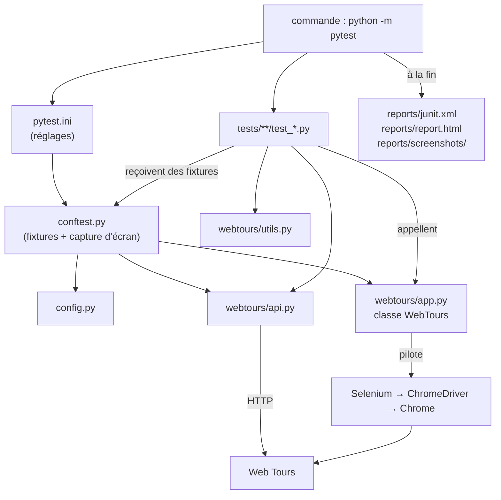
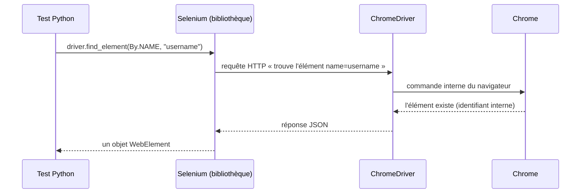

# Comment fonctionnent les tests automatisés

Ce document apprend **Selenium, PyTest et Cypress depuis zéro**, puis montre
**exactement ce qui se passe quand on lance les tests** : quel fichier démarre tout,
quelles fonctions sont appelées, dans quel ordre, et ce que chacune renvoie.

Pour la vue d'ensemble du projet (Jira, Xray, Jenkins), voir `docs/GUIDE-QA.md`.

**Sommaire**

- [Partie 0 : la carte des fichiers](#partie-0--la-carte-des-fichiers)
- [Partie 1 : leçon Selenium](#partie-1--leçon-selenium)
- [Partie 2 : leçon PyTest](#partie-2--leçon-pytest)
- [Partie 3 : le déroulement réel d'une exécution Selenium, pas à pas](#partie-3--le-déroulement-réel-dune-exécution-selenium-pas-à-pas)
- [Partie 4 : référence des fonctions Python (paramètres et retours)](#partie-4--référence-des-fonctions-python-paramètres-et-retours)
- [Partie 5 : leçon Cypress](#partie-5--leçon-cypress)
- [Partie 6 : le déroulement réel d'une exécution Cypress, pas à pas](#partie-6--le-déroulement-réel-dune-exécution-cypress-pas-à-pas)
- [Partie 7 : après les tests (rapport et Xray)](#partie-7--après-les-tests-rapport-et-xray)
- [Partie 8 : la même action dans les deux outils](#partie-8--la-même-action-dans-les-deux-outils)
- [Partie 9 : écrire un nouveau test, et comprendre un échec](#partie-9--écrire-un-nouveau-test-et-comprendre-un-échec)

---

## Partie 0 : la carte des fichiers

### Suite Selenium (Python), dossier `webtours-tests/`

```
webtours-tests/
├── pytest.ini          ① lu en premier : réglages de PyTest
├── conftest.py         ② chargé ensuite : prépare navigateur, comptes, captures
├── config.py           ③ constantes : adresses, mot de passe, carte de test…
├── requirements.txt       liste des bibliothèques à installer
├── webtours/
│   ├── app.py          ④ « Page Object » : toutes les actions sur le site
│   ├── api.py          ⑤ appels HTTP directs (création de comptes)
│   └── utils.py        ⑥ petites aides : dates, lecture des prix
└── tests/              ⑦ les 45 tests, un fichier par thème
    ├── ft/  test_ft_smoke.py, test_ft_auth.py, test_ft_search.py,
    │        test_ft_booking.py, test_ft_itinerary.py
    ├── et/  test_et_auth.py, test_et_search_payment.py
    ├── bt/  test_bt.py
    └── pt/  test_pt.py
```

**Qui appelle qui :**



### Suite Cypress (JavaScript), dossier `cypress-tests/`

```
cypress-tests/
├── package.json             déclare Cypress comme dépendance (npm install)
├── cypress.config.js     ① lu en premier : adresse du site, dossiers, rapport
└── cypress/
    ├── support/e2e.js    ② chargé avant chaque fichier de test : commandes maison
    └── e2e/webtours.cy.js ③ les 6 tests
```

### Les scripts lancés après les tests, dossier `scripts/`

| Script | Lit | Produit |
|---|---|---|
| `check_app.py` | rien (interroge le site) | code de sortie 0 (OK) ou 1 (site injoignable) |
| `make_report.py` | `junit.xml` + `xray_map.json` | `docs/execution-report.md` |
| `results_to_xray.py` | `junit.xml` + `xray_map.json` | une Test Execution dans Xray (ex. `WT-74`) |

---

## Partie 1 : leçon Selenium

### 1.1 L'idée

Selenium est une **bibliothèque** (un ensemble de fonctions prêtes à l'emploi) qui
permet à un programme de **piloter un vrai navigateur**, exactement comme un humain :
ouvrir une adresse, trouver un champ, taper du texte, cliquer, lire ce qui s'affiche.

Comment ça marche sous le capot :



- **ChromeDriver** est un petit programme fourni par Google qui traduit les ordres de
  Selenium en actions dans Chrome. Selenium le télécharge tout seul au premier
  lancement (outil intégré *Selenium Manager*).
- Chaque ligne Selenium = **un aller-retour** avec le navigateur.

### 1.2 Un premier script complet (hors du projet, pour apprendre)

```python
from selenium import webdriver
from selenium.webdriver.common.by import By

driver = webdriver.Chrome()                      # 1. ouvre Chrome, renvoie un "driver"
driver.get("https://example.com")                # 2. va à une adresse (ne renvoie rien)
titre = driver.find_element(By.TAG_NAME, "h1")   # 3. trouve un élément → WebElement
print(titre.text)                                # 4. lit son texte → "Example Domain"
assert titre.text == "Example Domain"            # 5. vérifie le résultat attendu
driver.quit()                                    # 6. ferme Chrome
```

Ces 6 gestes sont **toute la base**. Le reste du projet n'est que leur combinaison.

### 1.3 Les objets à connaître

| Objet | Ce que c'est | Obtenu par |
|---|---|---|
| `driver` (WebDriver) | la télécommande du navigateur | `webdriver.Chrome(options)` |
| `WebElement` | un élément de la page (champ, bouton, texte…) | `driver.find_element(...)` |
| `By` | la façon de chercher un élément | `from selenium.webdriver.common.by import By` |

### 1.4 Trouver un élément : les localisateurs

Une page web est du code HTML. Par exemple, le champ de connexion de Web Tours :

```html
<input type="text" name="username" maxlength="14">
```

On le retrouve grâce à un **localisateur** (`By.…`) :

| Localisateur | Exemple dans le projet | Trouve |
|---|---|---|
| `By.NAME` | `(By.NAME, "username")` | l'élément dont `name="username"` |
| `By.TAG_NAME` | `(By.TAG_NAME, "body")` | la première balise `<body>` |
| `By.XPATH` | `(By.XPATH, "//img[@alt='Itinerary Button']")` | l'image dont le texte alternatif est « Itinerary Button » |
| `By.CSS_SELECTOR` | `(By.CSS_SELECTOR, "input[name='seatType'][value='Business']")` | le bouton radio « Business » |

- `find_element(...)` renvoie **un** `WebElement`, ou lève une erreur
  `NoSuchElementException` s'il n'existe pas.
- `find_elements(...)` (avec un **s**) renvoie une **liste** (vide si rien trouvé).

### 1.5 Agir sur un élément

| Action | Code | Renvoie |
|---|---|---|
| Taper du texte | `champ.send_keys("wttester")` | rien |
| Vider un champ | `champ.clear()` | rien |
| Cliquer | `bouton.click()` | rien |
| Lire le texte visible | `element.text` | `str` |
| Lire un attribut | `element.get_attribute("value")` | `str` ou `None` |
| Case cochée ? | `case.is_selected()` | `True` / `False` |
| Choisir dans une liste | `Select(element).select_by_visible_text("Denver")` | rien |

### 1.6 Attendre : le piège n°1 de l'automatisation

Un programme va beaucoup plus vite qu'une page qui se charge. Si on cherche un
élément avant qu'il n'apparaisse, le test échoue « au hasard ». La solution est
l'**attente explicite** : « réessaie pendant 10 secondes au maximum jusqu'à ce que la
condition soit vraie ».

```python
from selenium.webdriver.support.ui import WebDriverWait
from selenium.webdriver.support import expected_conditions as EC

WebDriverWait(driver, 10).until(
    EC.presence_of_element_located((By.NAME, "username"))
)   # renvoie l'élément dès qu'il existe ; erreur TimeoutException après 10 s
```

On peut aussi donner sa propre condition (une fonction qui renvoie `True`/`False`) :
c'est ce que fait `wait_for_info` dans `app.py` (partie 4).

### 1.7 Les frames : la particularité de Web Tours

Web Tours affiche **des pages dans des pages** (des *frames*) :

```
index.htm
├── frame "header"        (bandeau du haut)
└── frame "body"
    ├── frame "navbar"    (menu de gauche : connexion, boutons)
    └── frame "info"      (contenu : recherche, paiement, facture…)
```

Selenium ne voit qu'**une frame à la fois**. Pour toucher au menu, il faut d'abord
« entrer » dans `body`, puis dans `navbar` :

```python
driver.switch_to.default_content()   # revenir tout en haut (index.htm)
driver.switch_to.frame("body")       # entrer dans la frame "body"
driver.switch_to.frame("navbar")     # puis dans "navbar"
driver.find_element(By.NAME, "username")   # maintenant on le trouve
```

Dans le projet, cette gymnastique est cachée dans une seule méthode, `_goto`, que
toutes les autres utilisent (partie 4).

### 1.8 Les options du navigateur

```python
options = Options()
options.add_argument("--headless=new")        # pas de fenêtre visible (serveur, Jenkins)
options.add_argument("--window-size=1400,1000")
driver = webdriver.Chrome(options=options)
```

---

## Partie 2 : leçon PyTest

Selenium sait piloter un navigateur, mais il ne sait pas **organiser, lancer et compter
des tests**. C'est le rôle de **PyTest**.

### 2.1 Un test = une fonction qui commence par `test_`

```python
def test_addition():
    resultat = 2 + 2
    assert resultat == 4      # vrai → le test PASSE
                              # faux → AssertionError → le test ÉCHOUE
```

PyTest trouve tout seul ces fonctions (dans les fichiers `test_*.py`), les exécute une
par une et affiche un bilan : `31 passed, 14 xfailed`.

### 2.2 `assert` : la vérification

`assert condition` signifie « vérifie que la condition est vraie ». C'est la traduction
du **résultat attendu** d'un cas de test. Si elle est fausse, PyTest affiche les
valeurs comparées, ce qui aide à comprendre l'échec :

```
assert 'thank you' in 'error: invalid card'
AssertionError
```

### 2.3 Les fixtures : préparer et ranger automatiquement

Beaucoup de tests ont besoin de la même préparation (ouvrir Chrome, créer un compte,
se connecter). Plutôt que de la répéter, on écrit une **fixture** : une fonction
marquée `@pytest.fixture`, que PyTest exécute **avant** le test.

```python
@pytest.fixture
def driver():
    drv = build_driver()   # AVANT le test : ouvrir Chrome
    yield drv              # donner le navigateur au test, puis attendre la fin du test
    drv.quit()             # APRÈS le test (même s'il a échoué) : fermer Chrome

def test_quelque_chose(driver):   # ← le nom du paramètre = le nom de la fixture
    driver.get("http://...")
```

Règles importantes :

- Un test **demande** une fixture en mettant son nom en paramètre.
- Une fixture peut elle-même demander d'autres fixtures : elles forment une **chaîne**.
- `return x` : la fixture donne `x` au test.
- `yield x` : la fixture donne `x`, puis reprend après le test pour **ranger**.
- `scope="session"` : la fixture n'est exécutée qu'**une fois** pour toute la session
  (sinon, une fois par test).
- Les fixtures partagées sont dans **`conftest.py`**, que PyTest charge automatiquement.

### 2.4 Les marqueurs

```python
pytestmark = pytest.mark.et    # en haut d'un fichier : tous ses tests sont "et"
```

On peut alors lancer une seule famille : `pytest -m et`.

Le marqueur `xfail` signale un **échec attendu** (bug connu) :

```python
@pytest.mark.xfail(reason="BUG-03: paiement accepte sans numero de carte", strict=False)
def test_et_11_...(...):
```

| Le test… | Sans `xfail` | Avec `xfail` |
|---|---|---|
| réussit | PASSED | XPASS (« réussi alors qu'on attendait un échec » : le bug est peut-être corrigé) |
| échoue | FAILED | XFAIL (échec attendu, ne casse pas la suite) |

### 2.5 Les hooks : se brancher sur les événements de PyTest

Un **hook** est une fonction au nom imposé que PyTest appelle à un moment précis.
Le projet en utilise deux, dans `conftest.py` :

| Hook | Appelé quand | Utilisé pour |
|---|---|---|
| `pytest_configure(config)` | une fois, au démarrage | créer les dossiers `reports/` et `reports/screenshots/` |
| `pytest_runtest_makereport(item, call)` | après chaque phase de chaque test | prendre une capture d'écran si le test a échoué |

### 2.6 `pytest.ini` : les réglages

```ini
[pytest]
testpaths = tests                 # où chercher les tests
python_files = test_*.py          # quels fichiers sont des fichiers de test
addopts = -q --junitxml=reports/junit.xml --html=reports/report.html --self-contained-html
markers =                         # déclaration des marqueurs ft, et, bt, pt, bug
    ft: tests fonctionnels (happy path)
    ...
```

`addopts` ajoute ces options à **chaque** lancement : c'est pourquoi les rapports
`junit.xml` et `report.html` sont toujours produits sans rien demander.

---

## Partie 3 : le déroulement réel d'une exécution Selenium, pas à pas

On suit la commande :

```powershell
cd webtours-tests
..\.venv\Scripts\python -m pytest
```

### Étape 1 : PyTest lit `pytest.ini`

Il apprend : chercher dans `tests/`, fichiers `test_*.py`, produire `junit.xml` et
`report.html`, accepter les marqueurs `ft/et/bt/pt/bug`.

### Étape 2 : PyTest charge `conftest.py`

En haut du fichier, au chargement :

```python
ROOT = Path(__file__).resolve().parent     # = le dossier webtours-tests
sys.path.insert(0, str(ROOT))              # permet "import config" et "import webtours"

import config as cfg                       # charge config.py
from webtours import WebTours              # charge webtours/app.py
from webtours import api                   # charge webtours/api.py
```

`config.py` lit les **variables d'environnement** (avec des valeurs par défaut) :

```python
BASE_URL = os.getenv("WEBTOURS_URL", "http://127.0.0.1:1080/WebTours/index.htm")
CGI_URL  = os.getenv("WEBTOURS_CGI", "http://127.0.0.1:1080/cgi-bin")
HEADLESS = os.getenv("HEADLESS", "1").lower() not in ("0", "false", "no")   # True par défaut
TIMEOUT  = int(os.getenv("WEBTOURS_TIMEOUT", "10"))                          # 10 secondes
PASSWORD = "Passw0rd"
VALID_CARD, VALID_EXP = "12345678", "12/30"
```

C'est ce qui permet à Jenkins (dans Docker) de viser une autre adresse sans changer
le code : il définit simplement `WEBTOURS_URL`.

### Étape 3 : le hook `pytest_configure`

```python
def pytest_configure(config):
    REPORTS.mkdir(exist_ok=True)       # webtours-tests/reports/
    SCREENSHOTS.mkdir(exist_ok=True)   # webtours-tests/reports/screenshots/
```

### Étape 4 : la collecte

PyTest ouvre chaque `tests/**/test_*.py`, liste les fonctions `test_*` et regarde leurs
marqueurs : **45 tests collectés**.

### Étape 5 : pour chaque test, la chaîne de fixtures

Prenons `test_et_11_payment_without_credit_card_is_rejected(logged_app)`. Il demande
`logged_app`, qui demande `app` et `user`, et `app` demande `driver`. PyTest construit
donc la chaîne **dans cet ordre** (sortie réelle de `pytest --setup-show`) :

```
SETUP    F driver
SETUP    F app (fixtures used: driver)
SETUP    F user
SETUP    F logged_app (fixtures used: app, user)
    test_et_11_payment_without_credit_card_is_rejected  XFAIL
TEARDOWN F logged_app
TEARDOWN F user
TEARDOWN F app
TEARDOWN F driver
```

Le détail de chaque maillon :

**① `driver`** : ouvre Chrome

```python
@pytest.fixture
def driver():
    drv = build_driver()     # → objet WebDriver (Chrome ouvert, sans fenêtre)
    yield drv
    drv.quit()               # rangement : ferme Chrome
```

`build_driver()` prépare les options (headless, taille de fenêtre, `--no-sandbox`
pour Docker, chemin de Chromium si `CHROME_BIN` est défini), puis :
`webdriver.Chrome(options=options)` → **renvoie le driver**.
Si `SELENIUM_REMOTE_URL` est défini, il utilise à la place un navigateur distant
(Selenium Grid) avec `webdriver.Remote(...)`.

**② `app`** : ouvre le site

```python
@pytest.fixture
def app(driver):
    return WebTours(driver).open()     # → objet WebTours, positionné sur la page d'accueil
```

`WebTours(driver)` crée le page object ; `.open()` fait `driver.get(BASE_URL)`, attend
que la frame `body` existe, et **renvoie l'objet lui-même** (`return self`), ce qui
permet d'enchaîner les appels.

**③ `user`** : crée un compte neuf, sans navigateur

```python
@pytest.fixture
def user():
    user = api.new_credentials()   # → {"username": "wt3fa91c2d", "password": "Passw0rd", ...}
    api.register(user)             # → POST /cgi-bin/login.pl (formulaire d'inscription)
    return user                    # → le dictionnaire
```

L'inscription passe par une **requête HTTP directe** (bibliothèque `requests`) plutôt
que par le navigateur : c'est 10 fois plus rapide, et ce n'est pas ce que ce test
vérifie. Le nom aléatoire garantit que chaque test a **son propre compte**.

**④ `logged_app`** : se connecte

```python
@pytest.fixture
def logged_app(app, user):
    app.login(user["username"], user["password"])   # remplit le menu et clique "Login"
    app.wait_for_info("welcome,")                   # attend "Welcome, ..." dans la frame info
    return app                                      # → le même objet WebTours, connecté
```

### Étape 6 : le corps du test

```python
@pytest.mark.xfail(reason="BUG-03: paiement accepte sans numero de carte", strict=False)
def test_et_11_payment_without_credit_card_is_rejected(logged_app):
    _reach_payment(logged_app)
    logged_app.pay(card="", exp=config.VALID_EXP)
    assert "please" in logged_app.page_text().lower() or "invalid" in logged_app.page_text().lower()
```

Voici **l'arbre complet des appels**, jusqu'aux commandes Selenium, avec ce que
chaque fonction renvoie :

```
test_et_11(logged_app)
│
├─ _reach_payment(app)                                   (dans le même fichier de test)
│  ├─ app.search(depart="Denver", arrive="Frankfurt", depart_date=future(2),
│  │             passengers=1, roundtrip=False)
│  │  │   future(2) → "10/24/2026"                        (utils.py : date du jour + 2, format MM/JJ/AAAA)
│  │  ├─ app.fill_search(...)
│  │  │  ├─ app.goto_search()
│  │  │  │  └─ app.goto("Search Flights Button")
│  │  │  │     ├─ app.navbar() → _goto("body", "navbar")  switch_to.frame ×2
│  │  │  │     ├─ find_element(By.XPATH, "//img[@alt='Search Flights Button']").click()
│  │  │  │     └─ _goto("body", "info")                   → self
│  │  │  ├─ Select(find_element(By.NAME, "depart")).select_by_visible_text("Denver")
│  │  │  ├─ Select(find_element(By.NAME, "arrive")).select_by_visible_text("Frankfurt")
│  │  │  ├─ departDate : clear() puis send_keys("10/24/2026")
│  │  │  ├─ numPassengers : clear() puis send_keys("1")
│  │  │  ├─ case "roundtrip" : click() seulement si son état ≠ False
│  │  │  └─ → self
│  │  ├─ app.info()
│  │  ├─ find_element(By.NAME, "findFlights").click()     (le site affiche 4 vols)
│  │  └─ → self
│  │
│  └─ app.select_flight(outbound=0)
│     ├─ radios = find_elements(By.NAME, "outboundFlight")   → liste de 4 WebElement
│     ├─ radios[0].click()
│     ├─ chosen = radios[0].get_attribute("value").split(";")  → ["040", "657", "10/24/2026"]
│     ├─ find_element(By.NAME, "reserveFlights").click()       (page de paiement)
│     └─ → chosen (liste de textes : numéro de vol, prix, date)
│
├─ app.pay(card="", exp="12/30")
│  ├─ app.info()
│  ├─ (prénom, nom, adresse : non fournis → laissés tels quels)
│  ├─ creditCard : clear()  ; card="" donc on ne tape rien
│  ├─ expDate : clear() puis send_keys("12/30")
│  ├─ case "saveCC" : laissée décochée
│  ├─ find_element(By.NAME, "buyFlights").click()
│  └─ → self
│
├─ app.page_text()
│  └─ _info_text() → info() puis find_element(By.TAG_NAME, "body").text
│     → "Invoice ... Thank you for booking through Web Tours ..."   (str)
│
└─ assert "please" in texte or "invalid" in texte
   → FAUX : le site a accepté le paiement (c'est le bug WT-69)
   → AssertionError
   → comme le test est marqué xfail : résultat XFAIL
```

### Étape 7 : le hook de capture d'écran

Après chaque phase, PyTest appelle `pytest_runtest_makereport`. Le hook regarde le
résultat et, **si la phase « call » (le corps du test) a vraiment échoué**, enregistre
une capture d'écran :

```python
if report.when == "call" and report.failed:
    driver = item.funcargs.get("driver")                # le navigateur du test
    driver.save_screenshot(str(SCREENSHOTS / f"{name}.png"))
```

Un XFAIL n'est pas considéré comme un échec : pas de capture. Une vraie régression
produit `reports/screenshots/test_xxx.png`, qui montre l'écran au moment de l'échec.

### Étape 8 : le rangement (teardown)

Les fixtures sont défaites **dans l'ordre inverse** : `logged_app`, `user`, `app`, puis
`driver`, dont le code après `yield` ferme Chrome (`drv.quit()`). Le test suivant
repart d'un **navigateur neuf**.

### Étape 9 : fin de session, écriture des rapports

Une fois les 45 tests passés, PyTest écrit (grâce à `addopts`) :

- `reports/junit.xml` : un `<testcase>` par test, avec `<skipped type="pytest.xfail">`
  pour les xfail et `<failure>` pour les vrais échecs ;
- `reports/report.html` : le rapport lisible ;

et affiche : `31 passed, 14 xfailed in 212.79s`.

**Code de sortie** de la commande : `0` si aucun échec inattendu, `1` sinon. C'est ce
code que Jenkins regarde pour colorer le build.

---

## Partie 4 : référence des fonctions Python (paramètres et retours)

### `webtours/app.py` : classe `WebTours` (le page object)

Créée par `WebTours(driver)`. La plupart des méthodes renvoient `self`, ce qui permet
d'écrire `app.open().login(u, p)`.

**Navigation entre frames**

| Méthode | Ce qu'elle fait | Renvoie |
|---|---|---|
| `_goto(*names)` | revient en haut, puis entre dans chaque frame nommée, en attendant qu'elle existe | `self` |
| `navbar()` | `_goto("body", "navbar")` : le menu | `self` |
| `info()` | `_goto("body", "info")` : le contenu | `self` |
| `open()` | ouvre `BASE_URL` et attend la frame `body` | `self` |
| `goto(alt)` | clique l'image du menu dont `alt` vaut `alt`, puis passe dans `info` | `self` |
| `goto_search()`, `goto_itinerary()`, `goto_home()` | raccourcis de `goto` | `self` |

**Connexion et inscription**

| Méthode | Ce qu'elle fait | Renvoie |
|---|---|---|
| `login(username, password)` | remplit le menu et clique « Login » | `self` |
| `wait_for_info(text, timeout=None)` | attend (10 s max) que la frame `info` contienne `text` | `self` (ou `TimeoutException`) |
| `is_logged_in(username=None)` | « Welcome, » (et le nom) présent dans `info` ? | `bool` |
| `error_message()` | texte de la frame `info` (ou `""`) | `str` |
| `sign_off()` | clique « Sign Off » et attend le formulaire de connexion | `self` |
| `submit_registration(username, password, confirm=None, …)` | remplit le formulaire d'inscription et valide ; bascule sur la nouvelle fenêtre si le site en ouvre une | `self` |
| `registration_text()` | texte de la page de réponse d'inscription | `str` |

**Recherche, réservation, paiement**

| Méthode | Ce qu'elle fait | Renvoie |
|---|---|---|
| `fill_search(depart, arrive, depart_date, return_date, passengers, seat_pref, seat_type, roundtrip)` | ouvre la recherche et remplit les champs fournis (les `None` sont ignorés) | `self` |
| `search(**mêmes paramètres)` | `fill_search` puis clic sur le bouton `findFlights` | `self` |
| `search_results()` | lit les boutons radio des vols proposés | `{"outbound": [(vol, prix, date), …], "return": [...]}` |
| `select_flight(outbound=0, inbound=None)` | coche le vol aller n° `outbound` (et retour), clique le bouton `reserveFlights` | `[vol, prix, date]` (textes) |
| `payment_form()` | lit la page de paiement | `{"total_text", "passengers": ["pass1", …], "first_name", "last_name"}` |
| `pay(card, exp, first_name, last_name, address1, address2, passenger_names, save_card)` | remplit le paiement et clique le bouton `buyFlights` | `self` |
| `book(outbound, inbound, card, exp, passengers, **recherche)` | `search` + `select_flight` + `pay` | `[vol, prix, date]` |
| `page_text()` | texte complet de la frame `info` | `str` |

**Itinéraire**

| Méthode | Ce qu'elle fait | Renvoie |
|---|---|---|
| `itinerary_text()` | ouvre l'itinéraire, renvoie son texte | `str` |
| `itinerary_rows()` | les cases à cocher (une par réservation) | `list[WebElement]` |
| `cancel_first_reservation()` | coche la 1re réservation, clique le bouton image « Cancel Reservation » (`removeFlights`) | `self` |
| `cancel_all_reservations()` | clique « Cancel All Reservations » (`removeAllFlights`) | `self` |

### `webtours/api.py` : appels HTTP sans navigateur

| Fonction | Ce qu'elle fait | Renvoie |
|---|---|---|
| `new_credentials(prefix="wt")` | fabrique un utilisateur au nom aléatoire (14 caractères max) | `dict` (username, password, firstName…) |
| `register(user, session=None)` | POST du formulaire d'inscription sur `login.pl` | le HTML de la réponse (`str`) |
| `get_direct(path, session=None)` | GET d'une page CGI **sans être connecté** (utilisé par les tests PT) | un objet `Response` (`.status_code`, `.text`) |

### `webtours/utils.py`

| Fonction | Renvoie | Exemple |
|---|---|---|
| `future(days=1)` | date future au format du site | `future(2)` → `"10/24/2026"` |
| `past(days=1)` | date passée | `past(60)` → `"08/23/2026"` |
| `total_from(text)` | le montant trouvé après « Total… » dans un texte, ou `None` | `"Total Charged … $ 543"` → `543.0` |

### `conftest.py` : les fixtures disponibles pour les tests

| Fixture | Dépend de | Portée | Donne au test |
|---|---|---|---|
| `driver` | — | par test | un Chrome ouvert (fermé après le test) |
| `app` | `driver` | par test | `WebTours` sur la page d'accueil |
| `user` | — | par test | un compte neuf (`dict`) |
| `logged_app` | `app`, `user` | par test | `WebTours` connecté avec ce compte neuf |
| `default_user` | — | **session** | le compte fixe `wttester` (créé une fois) |
| `existing_logged_app` | `app`, `default_user` | par test | `WebTours` connecté avec `wttester` |

---

## Partie 5 : leçon Cypress

### 5.1 L'idée, et la grande différence avec Selenium

Cypress fait le même travail que Selenium (piloter un navigateur), mais :

- il est écrit en **JavaScript** et s'installe avec `npm` ;
- il s'exécute **à l'intérieur** du navigateur, à côté du site testé ;
- il fournit **tout en un** : le lanceur de tests (comme PyTest), les vérifications,
  les captures d'écran, les rapports.

### 5.2 Les briques de base

```javascript
describe("Un groupe de tests", () => {      // regroupe des tests (comme un fichier PyTest)
  beforeEach(() => { /* ... */ });          // exécuté avant CHAQUE test (comme une fixture)

  it("FT-01 mon test", () => {              // un test (comme une fonction test_...)
    cy.visit("/WebTours/index.htm");        // ouvrir une page
    cy.get("input[name=username]")          // trouver un élément (sélecteur CSS)
      .type("wttester");                    // taper dedans
    cy.get("input[name=login]").click();    // cliquer
    cy.contains("Welcome");                 // vérifier qu'un texte apparaît
  });
});
```

| Commande Cypress | Équivalent Selenium |
|---|---|
| `cy.visit(url)` | `driver.get(url)` |
| `cy.get("input[name=username]")` | `driver.find_element(By.CSS_SELECTOR, "input[name=username]")` |
| `.type("abc")` | `.send_keys("abc")` |
| `.clear()` | `.clear()` |
| `.click()` | `.click()` |
| `.select("Denver")` | `Select(el).select_by_visible_text("Denver")` |
| `.check()` / `.uncheck()` | `click()` si l'état ne convient pas |
| `.should("contain.text", "x")` | `assert "x" in el.text` (+ attente automatique) |
| `cy.request(url)` | `requests.get(url)` |

### 5.3 Concept n°1 : les commandes sont mises en file d'attente

C'est le point le plus déroutant. Quand le code d'un test s'exécute, une ligne
`cy.get(...)` **ne cherche pas l'élément tout de suite** : elle **ajoute une commande
dans une file**. Une fois la fonction du test terminée, Cypress exécute la file, une
commande après l'autre.

Conséquence : on ne peut pas écrire `const champ = cy.get(...)` et utiliser `champ`
comme en Python. Pour récupérer une valeur, on utilise `.then(...)` :

```javascript
cy.register().then((u) => { user = u; });   // "quand register aura fini, garde son résultat"
```

### 5.4 Concept n°2 : chaque commande « donne » un sujet à la suivante

Au lieu de **renvoyer** une valeur, une commande Cypress **passe** son résultat (le
*sujet*, *yield* en anglais) à la commande enchaînée après elle :

```javascript
cy.get("input[name=outboundFlight]")   // donne : les 4 boutons radio
  .first()                             // donne : le premier
  .check();                            // le coche
```

### 5.5 Concept n°3 : attente et nouvelle tentative automatiques

Une vérification `.should(...)` est **réessayée automatiquement** jusqu'à ce qu'elle
réussisse, pendant 10 secondes (`defaultCommandTimeout` dans la configuration). Il n'y
a donc pas d'équivalent de `WebDriverWait` à écrire : c'est la raison principale pour
laquelle Cypress est agréable.

### 5.6 `within` et `wrap`

- `.within(() => { ... })` : toutes les commandes à l'intérieur cherchent **uniquement
  dans l'élément courant** (ici : à l'intérieur d'une frame).
- `cy.wrap(objet)` : transforme un objet JavaScript ordinaire en sujet Cypress, pour
  pouvoir enchaîner `.find`, `.should`, `.within` dessus.

### 5.7 Les commandes maison

On peut créer ses propres commandes avec `Cypress.Commands.add(nom, fonction)`, puis
les utiliser comme `cy.nom(...)`. C'est l'équivalent Cypress du page object : le projet
en définit 6 dans `cypress/support/e2e.js` (`frame`, `openApp`, `register`, `login`,
`menu`, `searchOneWay`).

### 5.8 Le problème des frames dans Cypress

Cypress **n'a pas de commande pour entrer dans une frame**. Le projet contourne le
problème avec la commande maison `cy.frame(nom, texte)` : elle récupère la frame
`body`, puis lit directement le document de la frame intérieure (`contentDocument`),
attend que son contenu soit chargé (et contienne `texte` si demandé), et donne son
`<body>` comme sujet :

```javascript
Cypress.Commands.add("frame", (name, text) => {
  return cy
    .get('frame[name="body"]')               // la frame extérieure
    .should(($outer) => {                    // réessayé jusqu'à ce que tout soit vrai :
      const inner = $outer[0].contentDocument.querySelector(`frame[name="${name}"]`);
      const body = inner && inner.contentDocument && inner.contentDocument.body;
      expect(body).to.exist;                 //   la frame intérieure est chargée
      if (text) expect(body.innerText.toLowerCase()).to.contain(text.toLowerCase());
    })
    .then(($outer) => {
      const inner = $outer[0].contentDocument.querySelector(`frame[name="${name}"]`);
      return cy.wrap(inner.contentDocument.body);   // sujet donné : le <body> de la frame
    });
});
```

C'est le passage le plus technique de la suite Cypress, et la raison pour laquelle la
comparaison conclut que Selenium convient mieux à Web Tours.

---

## Partie 6 : le déroulement réel d'une exécution Cypress, pas à pas

On suit la commande :

```powershell
cd cypress-tests
npx cypress run
```

### Étape 1 : `npx` trouve Cypress

`npx` lance le programme `cypress` installé dans `node_modules/` par `npm install`.

### Étape 2 : lecture de `cypress.config.js`

```javascript
module.exports = defineConfig({
  e2e: {
    baseUrl: process.env.WEBTOURS_HOST || "http://127.0.0.1:1080",  // préfixe de cy.visit / cy.request
    specPattern: "cypress/e2e/**/*.cy.js",     // où sont les tests
    supportFile: "cypress/support/e2e.js",     // chargé avant chaque fichier de test
    defaultCommandTimeout: 10000,              // attente automatique max : 10 s
    video: false,
    screenshotOnRunFailure: true,              // capture d'écran si un test échoue
    chromeWebSecurity: false,
  },
  reporter: "junit",                           // format de rapport (comme PyTest)
  reporterOptions: { mochaFile: "reports/junit.xml" },
});
```

### Étape 3 : lancement du navigateur

`cypress run` démarre **Electron** (le navigateur intégré à Cypress, basé sur Chromium)
sans fenêtre visible. `npx cypress open` ouvre au contraire l'interface interactive.

### Étape 4 : chargement de `support/e2e.js`

Les 6 commandes maison sont enregistrées (`Cypress.Commands.add`). Rien n'est encore
exécuté sur le site.

### Étape 5 : chargement de `e2e/webtours.cy.js`

Cypress lit le `describe` et ses 6 `it`. Pour **chaque** `it`, il fait :

1. exécuter le `beforeEach`, **et attendre que ses commandes soient finies** ;
2. exécuter la fonction du `it`, qui remplit la file de commandes ;
3. exécuter la file ; à la première vérification qui échoue (après 10 s de
   tentatives), le test s'arrête et une capture d'écran est prise.

### Étape 6 : le `beforeEach` crée un compte neuf

```javascript
let user;
beforeEach(() => {
  cy.register().then((u) => { user = u; });
});
```

```
cy.register("cy")
├─ fabrique username = "cy" + 8 caractères aléatoires   (14 max)
├─ cy.request({ method: "POST", url: "/cgi-bin/login.pl", form: true, body: {...} })
│     → requête HTTP directe, sans navigateur (comme api.register en Python)
└─ .then(() => ({ username, password: "Passw0rd" }))
      → sujet donné : { username, password }
.then((u) => { user = u; })   → la variable user est remplie pour le test
```

### Étape 7 : le test FT-10, commande par commande

```javascript
it("FT-10 reservation complete : facture affichee", () => {
  cy.openApp();
  cy.login(user.username, user.password);
  cy.frame("info", "welcome,");
  cy.searchOneWay();
  cy.frame("info", "Flight departing from").within(() => {
    cy.get("input[name=outboundFlight]").first().check();
    cy.get("input[name=reserveFlights]").click();
  });
  cy.frame("info", "Payment Details").within(() => {
    cy.get("input[name=creditCard]").clear().type("12345678");
    cy.get("input[name=expDate]").clear().type("12/30");
    cy.get("input[name=buyFlights]").click();
  });
  cy.frame("info", "Thank you for booking through Web Tours");
});
```

L'arbre des appels, avec le sujet donné par chaque commande :

```
FT-10
├─ cy.openApp()
│  ├─ cy.visit("/WebTours/index.htm")              → ouvre http://127.0.0.1:1080/WebTours/index.htm
│  └─ cy.frame("navbar").find("input[name=username]").should("exist")
│                                                  → attend que le menu soit chargé
├─ cy.login(user.username, "Passw0rd")
│  └─ cy.frame("navbar").within(...)
│     ├─ cy.get("input[name=username]").clear().type(username)
│     ├─ cy.get("input[name=password]").clear().type(password)
│     └─ cy.get("input[name=login]").click()
├─ cy.frame("info", "welcome,")                    → attend « Welcome, … » (connexion réussie)
├─ cy.searchOneWay()
│  ├─ cy.menu("Search Flights Button")             → clic sur l'image du menu
│  └─ cy.frame("info", "Find Flight").within(...)
│     ├─ select depart = "Denver", arrive = "Frankfurt"
│     ├─ departDate = date du jour + 2, numPassengers = "1"
│     ├─ roundtrip décoché
│     └─ clic "findFlights"
├─ cy.frame("info", "Flight departing from")       → sujet : <body> de la page des vols
│  └─ within : premier vol coché, clic "reserveFlights"
├─ cy.frame("info", "Payment Details")             → sujet : <body> de la page de paiement
│  └─ within : carte 12345678, expiration 12/30, clic "buyFlights"
└─ cy.frame("info", "Thank you for booking through Web Tours")
                                                   → la VÉRIFICATION finale : le texte doit
                                                     apparaître dans les 10 s, sinon échec
```

Remarque : dans Cypress, la dernière « vérification » est souvent l'attente elle-même.
`cy.frame("info", "Thank you…")` échoue si le texte n'apparaît pas : pas besoin
d'`assert` séparé.

### Étape 8 : fin

Cypress écrit `reports/junit.xml` (même format que PyTest), les captures des échecs dans
`cypress/screenshots/`, et affiche un tableau récapitulatif : `6 passing`.
Code de sortie : le **nombre de tests en échec** (0 = tout va bien).

### Le cas PT-01 : pas de `xfail` dans Cypress

Cypress n'a pas d'équivalent du `xfail`. Le test PT-01 vérifie donc **le comportement
actuel** (le défaut), et le dit dans son titre :

```javascript
it("PT-01 [BUG-04] itinerary.pl est servi sans session (defaut confirme)", () => {
  cy.request({ url: "/cgi-bin/itinerary.pl", followRedirect: false, failOnStatusCode: false })
    .then((r) => {
      expect(r.status).to.eq(200);                    // la page s'ouvre sans connexion…
      expect(String(r.body)).to.contain("Itinerary"); // …alors qu'elle devrait être protégée
    });
});
```

Le script `results_to_xray.py` repère `[BUG-` dans le titre et publie ce test en
**FAILED** dans Xray, comme le xfail de Selenium.

---

## Partie 7 : après les tests (rapport et Xray)

### `scripts/make_report.py`

```
main()
├─ lit scripts/xray_map.json
│    "tests":     { "ET-11": { "key": "WT-48", "folder": "/ET/Paiement", "story": "WT-15" }, ... }
│    "automated": { "test_et_11_payment_without_credit_card_is_rejected": "WT-48", ... }
├─ construit catalog : nom PyTest → { id "ET-11", dossier, story, clé Xray }
├─ lit webtours-tests/reports/junit.xml
├─ pour chaque <testcase> :
│    <failure> ou <error>       → FAILED
│    <skipped type="…xfail">    → FAILED (défaut confirmé)
│    rien                       → PASSED
├─ compte par statut et par dossier, trie FT → ET → BT → PT
└─ écrit docs/execution-report.md           → affiche "written … (45 tests)"
```

### `scripts/results_to_xray.py`

```
main()  options : --junit (défaut : rapport Selenium), --plan WT-65, --summary, --environments
├─ parse_junit(chemin)            → liste de (nom du test, statut, commentaire)
│     xfail                       → "FAILED", "Defaut confirme (xfail): …"
│     titre contenant "[BUG-"     → "FAILED"          (cas Cypress PT-01)
├─ pour chaque test : xray_key(nom, mapping) → clé Xray
│     1. nom PyTest trouvé dans "automated"  → ex. "WT-48"
│     2. sinon, identifiant dans le titre    → "FT-01 connexion…" → "WT-21"  (cas Cypress)
├─ construit le message pour Xray :
│     { "info": { "summary", "description", "project": "WT", "testPlanKey": "WT-65", dates },
│       "tests": [ { "testKey": "WT-48", "status": "FAILED", "comment": "…" }, ... ] }
├─ l'enregistre aussi dans reports/xray_import.json (pour vérifier)
├─ Xray().authenticate()          → jeton d'accès, avec les clés du fichier .env
├─ x.rest("import/execution", POST, message)
└─ affiche et renvoie la clé créée → "Test Execution: WT-74 (statuses: 31 PASSED / 14 FAILED)"
```

### `scripts/check_app.py` (lancé par Jenkins avant les tests)

Jusqu'à 5 essais, espacés de 3 secondes : GET de `index.htm` (doit contenir « Web
Tours »), puis GET d'une page Perl `welcome.pl` (doit répondre 200). Sortie `0` si tout
va bien, `1` sinon, ce qui arrête Jenkins avant de lancer 45 tests inutilement.

### L'ordre complet dans Jenkins (`Jenkinsfile`)

```
1. checkout scm                          récupère le code
2. python -m venv + pip install -r requirements.txt
3. python scripts/check_app.py           → 0, sinon arrêt
4. (dans webtours-tests/) python -m pytest     → junit.xml, report.html
5. python scripts/results_to_xray.py --plan WT-65   → nouvelle Test Execution
6. python scripts/make_report.py         → docs/execution-report.md
7. post : publie junit.xml (graphique), report.html (lien), archive reports/**
```

---

## Partie 8 : la même action dans les deux outils

**Se connecter et vérifier le message de bienvenue :**

<table>
<tr><th>Selenium + PyTest (Python)</th><th>Cypress (JavaScript)</th></tr>
<tr><td>

```python
def test_ft_01_login(app, user):
    app.navbar()   # entrer dans les frames
    d = app.driver
    d.find_element(By.NAME, "username").send_keys(user["username"])
    d.find_element(By.NAME, "password").send_keys(user["password"])
    d.find_element(By.NAME, "login").click()
    app.wait_for_info("welcome,")   # attente écrite à la main
    assert user["username"] in app.page_text()
```

</td><td>

```javascript
it("FT-01 login", () => {
  cy.openApp();
  cy.frame("navbar").within(() => {   // frames : commande maison
    cy.get("input[name=username]").type(user.username);
    cy.get("input[name=password]").type(user.password);
    cy.get("input[name=login]").click();
  });
  cy.frame("info", "welcome,")        // attente automatique
    .should("contain.text", user.username);
});
```

</td></tr>
</table>

| | Selenium + PyTest | Cypress |
|---|---|---|
| Une ligne de code… | s'exécute immédiatement et **renvoie** une valeur | est **mise en file** et **donne** un sujet à la suivante |
| Attendre la page | `WebDriverWait(...)` à écrire | automatique (`should`, 10 s) |
| Entrer dans une frame | `driver.switch_to.frame("body")` | pas prévu : `contentDocument` |
| Préparer un test | fixtures PyTest (`conftest.py`) | `beforeEach` |
| Réutiliser des actions | classe page object (`app.py`) | commandes maison (`support/e2e.js`) |
| Vérifier | `assert` | `.should(...)` / `expect(...)` |
| Bug connu | `@pytest.mark.xfail` | pas d'équivalent |

---

## Partie 9 : écrire un nouveau test, et comprendre un échec

### Ajouter un test Selenium, étape par étape

Exemple : vérifier qu'une réservation en classe « First » apparaît dans la facture.

1. Choisir le fichier selon la famille : fonctionnel → `tests/ft/test_ft_booking.py`.
2. Écrire une fonction `test_…` qui demande les fixtures nécessaires :

```python
def test_ft_18_first_class_is_used_in_invoice(logged_app):
    logged_app.search(depart="Denver", arrive="Paris", depart_date=future(3),
                      passengers=1, roundtrip=False, seat_type="First")
    logged_app.select_flight(outbound=0)
    logged_app.pay()                                   # carte de test par défaut
    assert "first class" in logged_app.page_text().lower()
```

3. Le lancer seul : `..\.venv\Scripts\python -m pytest -k ft_18`
4. Le voir travailler : `$env:HEADLESS="0"` avant la commande.
5. Pour le relier à Xray : l'ajouter au catalogue `scripts/xray_catalog.py`, puis
   relancer `scripts/xray_seed.py` (qui met à jour `xray_map.json`).

### Ajouter un test Cypress

Dans `cypress/e2e/webtours.cy.js`, ajouter un `it("FT-18 …", () => { ... })` en
réutilisant les commandes maison (`cy.openApp`, `cy.login`, `cy.searchOneWay`, `cy.frame`).
Mettre l'identifiant (`FT-18`) au début du titre : c'est lui qui permet à
`results_to_xray.py` de retrouver le test dans Xray.

### Lire un échec

| Message | Signification probable | Où regarder |
|---|---|---|
| `AssertionError` | le site ne fait pas ce qui est attendu : **bug** ou test faux | la capture dans `reports/screenshots/`, le rapport HTML |
| `TimeoutException` | un élément ou un texte n'est jamais apparu en 10 s | la capture : la page affichée était-elle la bonne ? |
| `NoSuchElementException` | l'élément n'existe pas (mauvais nom, ou mauvaise frame) | le code HTML de la page (clic droit → Inspecter) |
| `ConnectionError` / `ECONNREFUSED` | Web Tours n'est pas démarré | `scripts\start_webtours.bat`, puis `scripts\check_app.py` |
| HTTP 500 sur `cgi-bin` | Perl introuvable par Apache | relancer avec `scripts\start_webtours.bat` |
| Cypress : `Timed out retrying after 10000ms` | équivalent du `TimeoutException` | la capture dans `cypress/screenshots/`, ou `npx cypress open` pour rejouer pas à pas |

**Règle d'or** : avant de conclure « bug de l'application », refaire le test **à la
main** dans le navigateur. Si le site se comporte mal à la main aussi, c'est un bug à
signaler dans Jira ; sinon, c'est le test qu'il faut corriger.
